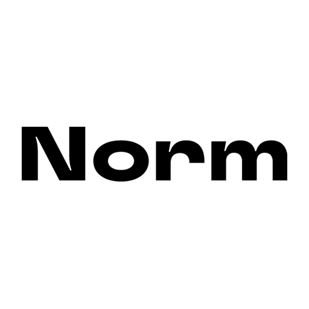

# Norm MCP connector

Book a beauty appointment at [Norm](https://norm.place) from ChatGPT, Claude or any MCP client.

Norm is a beauty salon in Warsaw with two studios, Kolejowa 45A and Jana Kazimierza 11A (Wola).
This remote MCP server lets an AI assistant read the live salon calendar: the menu and prices,
free times, and — once you sign in — your own appointments. Bookings made this way go into the
same calendar as bookings from our website.

**Connector URL:** `https://app.norm.place/api/mcp` (Streamable HTTP, OAuth 2.1)

Documentation page: <https://norm.place/en/ai>

> This repository is a public listing for directories: documentation, `server.json` and icon.
> It contains no server code. The server is hosted by Norm.

## Tools

No sign-in needed:

| Tool | What it does |
|---|---|
| `list_studios` | Both Warsaw studios with their addresses |
| `find_services` | The live service menu: prices, durations and which specialists perform each service |
| `find_slots` | Free times for a chosen service and studio over 1–7 days, optionally with one specialist, plus the service's add-ons |
| `verification_status` | Whether you are signed in (shows a masked phone number) |
| `sign_out` | Revokes the assistant's access token |

After you sign in with your phone:

| Tool | What it does |
|---|---|
| `book_appointment` | Books the exact service, time and studio you chose; availability is re-checked right before booking |
| `my_appointments` | Your upcoming visits; past visits only when you ask for them |
| `cancel_appointment` | Cancels a visit you booked |

## How to connect

**Claude** (web, desktop, mobile)

1. Open Settings → Connectors.
2. Choose "Add custom connector".
3. Paste `https://app.norm.place/api/mcp` and save. Nothing else to configure.

**ChatGPT**

1. Open Settings → Connectors and turn on developer mode.
2. Add a new connector and paste `https://app.norm.place/api/mcp`.
3. Enable the connector in a chat and ask about Norm.

**Other MCP clients:** add a remote server with transport Streamable HTTP and the URL above.
The client discovers OAuth automatically (`/.well-known/oauth-authorization-server`;
dynamic client registration and client ID metadata documents, PKCE S256).

## Signing in

Browsing the menu, prices and free times works without an account. The first time you book,
list or cancel, your assistant opens Norm's own sign-in page (`app.norm.place/oauth/authorize`).
There you enter your phone number and the 4-digit code we send by WhatsApp or SMS. The code is
entered only on that page — never type it into the chat, and the assistant will never ask for it.
Your assistant receives only an access token, not your code.

## Privacy

- We store your phone number and your appointments (with the first name and any note you give
  for a booking) — what is needed to attach the visit to you and confirm it.
- Access tokens are short-lived and stored only as hashes. You can revoke access at any time:
  ask the assistant to sign you out of Norm, or remove the connector.
- Privacy Policy: <https://norm.place/en/privacy> · Booking Terms: <https://norm.place/en/regulamin-rezerwacji>

## What it does not do

- No payments — it never asks for card or bank details; you pay at the studio.
- No medical or health data — it never asks for it.
- It does not guess: prices, durations and free times come from the live calendar, and a time
  can still be taken between searching and booking.

## Try asking

- "How much is a hybrid manicure at Norm and how long does it take?"
- "Is there a free eyebrow appointment at Norm tomorrow after 17:00?"
- "When is my next appointment at Norm? Cancel it, please."

## Support

Questions or problems: [hi@norm.place](mailto:hi@norm.place)

## License

The documentation in this repository is released under the [MIT License](LICENSE).
The Norm name and logo are trademarks of Norm and are not covered by the license.
